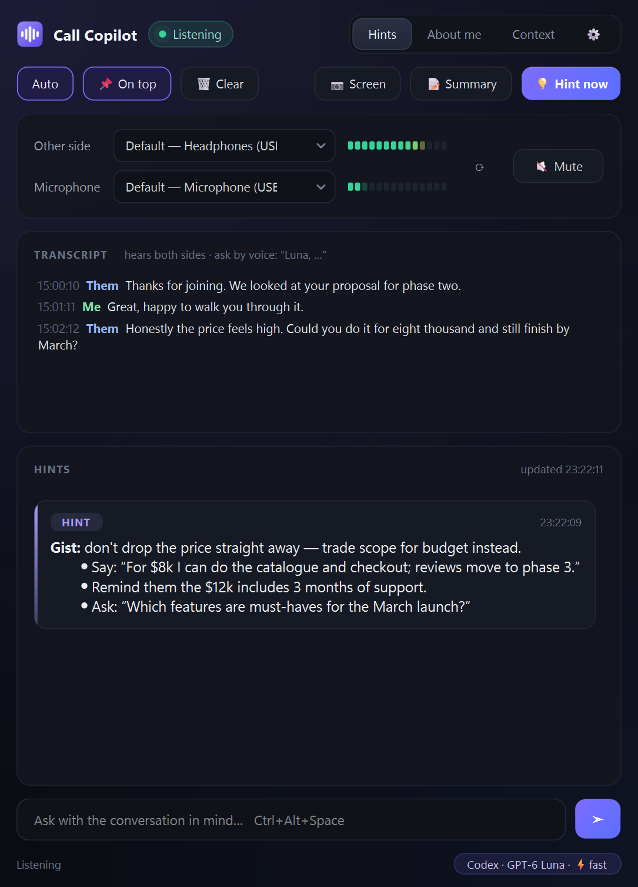

# Call Copilot

**English** · [Русский](README.ru.md)

A Windows desktop assistant for calls. It listens to the conversation (the other side through system
audio and you through the microphone), transcribes speech **locally** with Whisper and gives you hints
through the model of **your own ChatGPT or Claude subscription** — no API keys.



## Features

- **Live hints.** When the other side finishes speaking, a short hint appears: what you could answer,
  facts and numbers, risks, questions worth asking.
- **Hears both sides.** Your own lines are context for the model; hints are given on what the others say.
- **Ask by voice.** Start a phrase with the model's name — “Luna, …” with ChatGPT, “Sonnet, …” with Claude —
  and the model answers it as a question.
- **Screen review.** One click sends a screenshot (a document, contract, task, slide) to the model.
- **Call summary.** Agreements, open questions and next steps.
- **About me / Context.** Permanent information about you plus notes for each call — the model sees both.
- **Local speech recognition.** Audio never leaves your PC; only text goes to the model.
- **Echo filter, mute button, device picker, session logs**, English and Russian UI.

## Requirements

- Windows 10 (2004+) or Windows 11, 64-bit
- A **ChatGPT Plus/Pro** subscription (used through Codex CLI) **or** a **Claude Pro/Max** subscription
  (used through Claude Code)
- About 2 GB of disk space; a modern CPU (no GPU needed)

## Installation

Download `CallCopilot-Setup.exe` from [Releases](../../releases) and run it.

The installer puts the app into `%LOCALAPPDATA%\CallCopilot` without admin rights and checks and installs
what is missing: Python 3.12, the Visual C++ Runtime, Python libraries, Node.js + Codex CLI (or Claude Code),
and the speech recognition model. It helps you sign in to ChatGPT/Claude and creates desktop and Start menu
shortcuts. Running it again updates the app and keeps your About me, Context, settings and logs.

### If Windows says it is a virus

The installer is not code-signed (a certificate costs money), and it downloads Python, Node.js and the CLIs
and runs PowerShell — exactly what antivirus heuristics are wary of. So Windows may complain even though the
file is clean. The code is open: everything the installer does is in [`installer/setup.ps1`](installer/setup.ps1).

1. **Make sure the file is the real one.** Download it only from this repository's Releases and compare its
   checksum with the one in the release notes (PowerShell):
   ```powershell
   Get-FileHash .\CallCopilot-Setup.exe -Algorithm SHA256
   ```
   If the hash differs — do not run the file.
2. **“Windows protected your PC” (SmartScreen)** — click **More info → Run anyway**.
3. **Microsoft Defender deleted or blocked the file** — open **Windows Security → Virus & threat protection →
   Protection history**, find the entry for `CallCopilot-Setup.exe`, check that the path is your download and
   choose **Actions → Allow on device** (or **Restore**). Do not turn the antivirus off.
4. **The browser refuses to keep the download** — in Edge/Chrome open Downloads, click the file's **⋯** menu →
   **Keep** → **Keep anyway**.
5. **Still blocked?** Download `CallCopilot-Setup.zip` instead, unpack it and run `Setup.cmd` — it is the same
   installer as plain scripts you can read before running. Or install from source (below).

### From source

```bat
git clone <this repo>
cd call-copilot
installer\Setup.cmd
```

`Setup.cmd` runs the same installer from the source folder. To build `CallCopilot-Setup.exe` yourself:

```bat
powershell -ExecutionPolicy Bypass -File installer\build.ps1
```

### Uninstall

**Settings → Apps → Call Copilot → Uninstall**, or `Uninstall.cmd` in the app folder. It removes the app,
its shortcuts and the Apps entry, offers to keep your About me, Context and logs in Documents, and leaves
Python, Node.js, Claude Code and your sign-ins in place.

## Usage

1. Fill in the **About me** tab once — who you are, your work, how you like answers.
2. Before each call, put what matters for it into **Context** — who you are talking to, the goal, facts.
3. Pick the devices: **Other side** — where you hear the call (usually your headphones), **Microphone** —
   your mic. “Default” follows Windows.
4. Talk. Hints appear in the feed; scroll up to read older ones, “↓ Latest” brings auto-scroll back.
5. **⚙ Settings** — switch between ChatGPT and Claude and pick the model, right away. A subscription that is not
   connected yet shows **Connect**: a window opens that installs what is needed and signs you in; once both are
   connected you switch freely. Interface and conversation language are set there too.

| Button | Hotkey | What it does |
|---|---|---|
| Auto | — | a hint arrives on its own when the other side finishes speaking |
| 💡 Hint now | Ctrl+Alt+Enter | a hint for the current moment, without waiting for a pause |
| 📷 Screen | Ctrl+Alt+S | screenshot → the model goes through it with the conversation in mind |
| 📝 Summary | Ctrl+Alt+R | agreements, offers, open questions, your next steps |
| question box | Ctrl+Alt+Space | your own question, answered with the whole conversation in mind |
| 🔇 Mute | Ctrl+Alt+M | cut all audio from the app: nothing is recorded, transcribed or sent |
| 🗑 Clear | — | reset the conversation and Context (About me stays); the log starts a new file |
| 📌 On top | — | keep the window above other windows |

An answer takes about 5–10 seconds.

## Settings (`config.json`)

| Key | Default | Meaning |
|---|---|---|
| `backend` | `codex` | `codex` (ChatGPT subscription) or `claude` (Claude subscription) |
| `codex_model` | `gpt-6-luna` | Codex model; `codex_service_tier: "fast"` — 1.5x speed, uses limits faster |
| `claude_model` | `sonnet` | `sonnet`, `opus` or `haiku` |
| `ui_language` | auto | `en` or `ru`; empty — the Windows display language |
| `language` | auto | speech language for Whisper (`en`, `ru`, …, `auto`); empty — same as the UI |
| `whisper_model` | `small` | `medium` is more accurate but slower |
| `stt_hint` | — | names and terms that come up often — improves recognition |
| `extra_wake_words` | — | more words for voice questions; the model's own name (Luna / Sonnet / Opus / Haiku) always works |
| `echo_filter` | `true` | drops “Me” lines that are really the other side picked up by your mic |
| `debounce_ms` | `1200` | how long to wait after the other side stops before a hint |
| `vad_threshold` | `0.006` | speech loudness threshold: lower if phrases are missed, higher if noise gets in |

Devices list: `.venv\Scripts\python app.py --devices`.

## Privacy

- Audio is processed only on your computer by Whisper; recordings are not stored.
- The transcript, About me, Context and, on request, a screenshot are sent to OpenAI or Anthropic
  through the official CLI you signed in to — under your account and their terms.
- Transcripts and hints are saved locally in `logs\`. `about.md`, `context.md`, `config.json` and `logs\`
  stay on your PC and are excluded from git.

## Responsible use

Recording and transcribing conversations is regulated differently in different countries.
Tell the other participants that you use an AI assistant and transcription where the law or
common courtesy requires it, and do not use the app where AI assistance is not allowed.

## How it works

```
system audio (WASAPI loopback) ─┐
                                ├─> energy VAD ─> faster-whisper (CPU) ─> transcript ─┐
microphone ─────────────────────┘                                                      │
                                       About me + Context + transcript ─> codex exec / claude -p ─> hint feed
```

`app.py` — controller, `copilot/ui.py` — window (PyQt6), `audio.py` — capture, `stt.py` — speech recognition,
`llm.py` — model through the CLI, `echo.py` — echo filter, `prompts.py` — prompts, `i18n.py` — UI strings,
`installer/` — setup script and the `Setup.exe` builder.

## License

[MIT](LICENSE)
