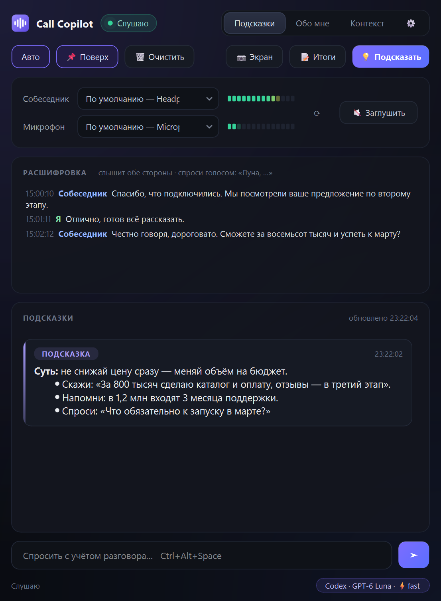

# Call Copilot

[English](README.md) · **Русский**

Помощник для созвонов под Windows. Слушает разговор (собеседника — через системный звук, тебя — через
микрофон), **локально** распознаёт речь Whisper'ом и подсказывает через модель **твоей подписки ChatGPT
или Claude** — без API-ключей.



## Возможности

- **Подсказки по ходу разговора.** Когда собеседник договорил, приходит короткая подсказка: что ответить,
  факты и цифры, риски, какие вопросы задать.
- **Слышит обе стороны.** Твои реплики — контекст для модели, подсказки — на реплики собеседника.
- **Вопрос голосом.** Начни фразу с имени модели — «Луна, …» с ChatGPT, «Соннет, …» с Claude, —
  и модель ответит на неё как на вопрос.
- **Разбор экрана.** Одной кнопкой отправить модели снимок экрана (документ, договор, задачу, слайд).
- **Итоги созвона.** Договорённости, открытые вопросы, следующие шаги.
- **Обо мне / Контекст.** Постоянная информация о тебе и заметки к конкретному созвону — модель видит обе.
- **Локальное распознавание речи.** Звук не покидает компьютер, модели уходит только текст.
- **Фильтр эха, кнопка «Заглушить», выбор устройств, журнал созвонов**, интерфейс на русском и английском.

## Требования

- Windows 10 (2004+) или Windows 11, 64 бит
- Подписка **ChatGPT Plus/Pro** (через Codex CLI) **или** **Claude Pro/Max** (через Claude Code)
- Около 2 ГБ на диске; обычный современный процессор (видеокарта не нужна)

## Установка

Скачай `CallCopilot-Setup.exe` из [Releases](../../releases) и запусти.

Установщик ставит программу в `%LOCALAPPDATA%\CallCopilot` без прав администратора и сам проверяет и
доставляет недостающее: Python 3.12, Visual C++ Runtime, библиотеки, Node.js + Codex CLI (или Claude Code),
модель распознавания речи. Помогает войти в аккаунт ChatGPT/Claude и создаёт ярлыки на рабочем столе и в
«Пуске». Повторный запуск — обновление: «Обо мне», контекст, настройки и журналы сохраняются.

> Windows SmartScreen может предупредить о неподписанной программе: **Подробнее → Выполнить в любом случае**.

### Из исходников

```bat
git clone <этот репозиторий>
cd call-copilot
installer\Setup.cmd
```

Собрать `CallCopilot-Setup.exe` самому:

```bat
powershell -ExecutionPolicy Bypass -File installer\build.ps1
```

### Удаление

**Параметры → Приложения → Call Copilot → Удалить** или `Uninstall.cmd` в папке программы. Удаляет программу,
ярлыки и запись в «Приложениях», предлагает сохранить «Обо мне», контекст и журналы в «Документы» и оставляет
Python, Node.js, Claude Code и вход в аккаунты на месте.

## Как пользоваться

1. Один раз заполни вкладку **Обо мне** — кто ты, работа, как тебе удобнее отвечать.
2. Перед каждым созвоном впиши в **Контекст** важное именно для него — с кем говоришь, цель, факты.
3. Выбери устройства: **Собеседник** — где ты слышишь созвон (обычно наушники), **Микрофон** — твой микрофон.
   «По умолчанию» — как в Windows.
4. Разговаривай. Подсказки появляются в ленте; пролистай вверх, чтобы перечитать старые, «↓ К последним»
   возвращает автопрокрутку.
5. **⚙ Настройки** — переключение между ChatGPT и Claude и выбор модели, сразу. У неподключённой подписки есть
   кнопка **«Подключить»**: откроется окно, которое само установит нужное и откроет вход; когда подключены обе —
   переключайся свободно. Там же язык интерфейса и язык разговора.

| Кнопка | Клавиши | Что делает |
|---|---|---|
| Авто | — | подсказка приходит сама, когда собеседник договорил |
| 💡 Подсказать | Ctrl+Alt+Enter | подсказка по текущему моменту, не дожидаясь паузы |
| 📷 Экран | Ctrl+Alt+S | снимок экрана → модель разбирает его с учётом разговора |
| 📝 Итоги | Ctrl+Alt+R | договорённости, предложения, открытые вопросы, твои шаги |
| поле ввода | Ctrl+Alt+Space | свой вопрос с учётом всего разговора |
| 🔇 Заглушить | Ctrl+Alt+M | отключить весь звук от программы: ничего не записывается и не уходит модели |
| 🗑 Очистить | — | сбросить разговор и «Контекст» («Обо мне» остаётся); журнал — новый файл |
| 📌 Поверх | — | держать окно поверх остальных |

Ответ приходит примерно за 5–10 секунд.

## Настройки (`config.json`)

| Ключ | По умолчанию | Что это |
|---|---|---|
| `backend` | `codex` | `codex` (подписка ChatGPT) или `claude` (подписка Claude) |
| `codex_model` | `gpt-6-luna` | модель Codex; `codex_service_tier: "fast"` — скорость 1.5x, быстрее тратит лимиты |
| `claude_model` | `sonnet` | `sonnet`, `opus` или `haiku` |
| `ui_language` | авто | `ru` или `en`; пусто — язык Windows |
| `language` | авто | язык речи для Whisper (`ru`, `en`, …, `auto`); пусто — как у интерфейса |
| `whisper_model` | `small` | `medium` точнее, но медленнее |
| `stt_hint` | — | имена и термины, которые часто звучат, — улучшает распознавание |
| `extra_wake_words` | — | дополнительные слова для вопроса голосом; имя модели (Луна / Соннет / Опус / Хайку) работает всегда |
| `echo_filter` | `true` | убирает из «Я» реплики собеседника, которые микрофон услышал из наушников |
| `debounce_ms` | `1200` | сколько ждать после реплики собеседника, прежде чем подсказывать |
| `vad_threshold` | `0.006` | порог громкости речи: уменьши, если фразы не ловятся; увеличь, если ловится шум |

Список устройств: `.venv\Scripts\python app.py --devices`.

## Приватность

- Звук обрабатывается только на твоём компьютере (Whisper), записи не сохраняются.
- Расшифровка, «Обо мне», «Контекст» и по запросу снимок экрана уходят в OpenAI или Anthropic через
  официальный CLI, в который ты вошёл, — под твоим аккаунтом и по их правилам.
- Расшифровки и подсказки сохраняются локально в `logs\`. `about.md`, `context.md`, `config.json` и `logs\`
  остаются на компьютере и исключены из git.

## Ответственное использование

Запись и расшифровка разговоров в разных странах регулируются по-разному. Предупреждай собеседников, что
пользуешься ИИ-помощником и расшифровкой, там, где этого требует закон или этикет, и не используй программу
там, где помощь ИИ запрещена.

## Лицензия

[MIT](LICENSE)
